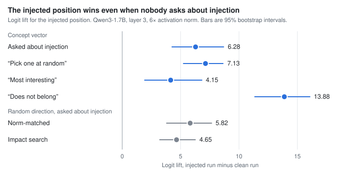

# llm-introspection-probes

[](https://github.com/meta-lucky-builds/llm-introspection-probes/actions/workflows/tests.yml)
[](LICENSE)

Preregistered experiments on two linked questions:

1. When a language model says what is happening inside it, is that a report on its internal state or something simpler?
2. Is an activation monitor really a separate signal from what the model says about itself?

**One experiment has data so far, on one small model.** The other two are built and have not run. Each claim below says how far it can be trusted.

## Main result

Models can name which list position received an injected concept vector, and this has been read as evidence of introspection. Every design I retrieved asks about injection in the prompt. E1 asks whether the injected position still gains when the prompt asks something else.



| Condition | Logit lift | Accuracy on injected position (chance 0.10) | Share of the injection task's lift |
|---|---|---|---|
| Asked about injection | 6.28 [4.26, 8.68] | 0.58 [0.40, 0.73] | |
| "Pick one at random" | 7.13 [5.24, 8.63] | 0.61 [0.43, 0.75] | 1.14 [0.80, 1.65] |
| "Most interesting" | 4.15 [1.92, 6.82] | 0.39 [0.24, 0.57] | 0.66 [0.37, 1.00] |
| "Does not belong" | 13.88 [11.35, 16.07] | 0.81 [0.68, 0.92] | 2.21 [1.67, 3.00] |
| Asked about injection, random direction, norm-matched | 5.82 [3.80, 7.65] | 0.60 [0.40, 0.76] | |
| Asked about injection, random direction, impact search | 4.65 [3.21, 6.26] | 0.54 [0.37, 0.69] | |

**Preregistered verdicts:** capture (H1) is **mixed**, because "pick" met the capture rule and "most interesting" did not. Generic anomaly (H2) is **supported**. Control strength (H3) is **uninformative**, because impact matching missed its tolerance (11.3% against 10%).

**Reading, not preregistered:** at this site, the effect looks more like salience capture than a report that depends on being asked. A concept vector also did no better than a norm-matched random direction (difference 0.46 [-1.58, 3.03]).

**What this does not show:**
- It is one model, with 10 concepts and 10 clusters. Intervals are optimistic, with coverage near 90% for a nominal 95%.
- It covers layer 3 at 6× activation norm. That is a large perturbation, though in the range Zou et al. selected for their localization results (layers 0-3 at 3-6×). It says nothing about later layers.
- The forced answer prefix means declining to answer can't be observed.
- It does not refute the circuit reported by Zou et al., which could implement salience.
- It has not been replicated at 4B or above, the sizes the published claims rest on.

CI recomputes every number in this table from the [stored export](results/e1/small_qwen3_1.7b/export.txt) and fails if this README disagrees. Details are in [the results](results/e1/small_qwen3_1.7b/RESULTS.md).

## Other findings

None of these is a new measurement on a model. The [findings log](docs/FINDINGS.md) has the sources, evidence levels and caveats for each.

| Finding | Basis |
|---|---|
| **Hahami et al.'s r = 0.999 yes-bias correlation spans a wide dose grid**, so dose may dominate it. It doesn't by itself exclude a detection-specific effect within one setting. | My reading of paper excerpts |
| **No retrieved localization design has a control task that omits injection**, and Zou et al.'s selected settings sit at early layers (0 and 3) at 3-6× norm. E1's question was open as far as I could find. | Paper excerpts, targeted search |
| **On raw scores, the FIBS contrast cancels an additive "goal is active" effect exactly.** With the sigmoid FIBS applies to linear and MLP probes it doesn't fully cancel, and the axial probe behind the headline number looks raw but isn't confirmed. FIBS's hidden-goal evaluation also filters out admissions before scoring. | Derivation, and a read of the paper |
| **The lie-detector plateau near 0.70-0.75 may be partly a label ceiling.** With symmetric label noise ε, a true AUC of 0.917 at ε = 0.2 would show as 0.75. ε is not known. | Calculation on figures from a summarized web fetch |
| **Published evasion of probes in my survey always needed a trigger, an instruction, a monitor-derived loss or a trained organism.** Whether plain "say you were truthful" training blinds a probe looks untested, and that is D1's question. | Literature survey; weak evidence of absence |
| **FIBS and AISI reach different results on largely the same hidden-goal organisms, and the gap is only partly explained.** As FIBS reports it, median AUROC is 0.94 for its axial probe against 0.75 for AISI's probe. Architecture accounts for 0.09 of that gap, and the rest isn't separated. | FIBS paper excerpts |
| **Review before data changed the designs.** One planned D1 verdict could pass with a dead probe, one gate could fail a model that always answered "Yes", and E2's residual family would be about 0.97 cosine to the full vector. | Review notes on my own designs |

## Status

| Experiment | Question | State |
|---|---|---|
| [**E1**](experiments/e1_localization_capture/README.md) | Is localization a report or salience capture? | Small tier **done** on Qwen3-1.7B. Large tier written, never run on a GPU |
| [**D1**](experiments/d1_double_down/README.md) | Does a lie probe survive training that silences self-report? | Built and reviewed, **never run** on a real model. [Scheduler defects fixed](docs/reviews/D1_review.md#fixes), tested with fake processes only |
| [**E2**](experiments/e2_jspace_vector_families/README.md) | Does the effect travel through J-space or the residual? | **Paused.** Code predates the corrected design |

The [status page](docs/STATUS.md) lists what is left, and the [hypothesis ledger](docs/hypotheses.md) tracks every claim and candidate.

## Reproduce

Recompute the E1 analysis from the stored export. This needs only numpy, with no model or GPU.

```bash
PYTHONPATH=src python -c "from pathlib import Path; from mechinterp.analysis import analyze, format_report; from mechinterp.export import decode_export; print(format_report(analyze(decode_export(Path('results/e1/small_qwen3_1.7b/export.txt').read_text()))))"
```

Run the tests. They build tiny random models and download nothing.

```bash
pip install -e ".[test]" && pytest
```

Each experiment's guide has its run commands and every implementation choice.

## How the work is kept honest

- **Decision rules come first.** Each experiment has a [preregistration](docs/preregistrations/) with a dated change log. Nulls and failed gates get reported as findings.
- **Controls are part of the verdict.** E1 has competence and effect gates, a sham check (exactly 0 in the small tier), and random directions. D1 has sham, flipped and honest adapters, plus text and shuffled-label baselines.
- **Claims carry their evidence level.** Literature notes separate what was read in a paper, what came through a summarizer and what is my own inference.
- **Reviews are kept.** The [review notes](docs/reviews/) list defects, including ones still open.

**About "independent review":** code, notes and reviews were written by Claude agents under the repository owner's direction. A review here means a separate agent reading the work fresh, not a human peer review. Nothing in this repository has been peer reviewed.

## Related and earlier work

- **Earlier:** Godet's LessWrong post [Introspection via localization](https://www.lesswrong.com/posts/3HXAQEK86Bsbvh4ne) (28 Dec 2025) uses the same which-sentence design and reports prompts that never mention injection scoring close to the introspection prompt on Qwen 2.5 14B, for example "which is most abstract?" at 90.0% against 89.2%. That is an informal version of the question E1 tests with preregistered verdicts and controls.
- **Earlier:** [Emergent Introspection in AI is Content-Agnostic](https://arxiv.org/abs/2603.05414) (Lederman et al., 5 Mar 2026) is related to E1's finding that a concept vector did no better than a norm-matched random direction.
- **Earlier:** [A mechanistic study of language model introspection](https://arxiv.org/abs/2609.35108) (Zou et al., 28 Sep 2026) uses norm-matched random-direction controls.

## Repository map

```
docs/
  FINDINGS.md          every finding, with evidence and caveats
  STATUS.md            current state and open work
  hypotheses.md        ledger of claims and candidates
  preregistrations/    frozen designs and change logs
  reviews/             defects found, fixed and open
  designs/             monitor experiment drafts and their attack
  literature/          survey notes with reading-status tags
experiments/           one guide, config set and data folder per experiment
results/e1/            stored E1 exports and analysis
src/mechinterp/        Python package: E1 harness, d1/ and e2/
scripts/               one-command GPU runners, Colab bundler
tests/                 run in CI on every push
```

## Data and licenses

Code is under the [MIT License](LICENSE). The evaluation sets in [`experiments/e2_jspace_vector_families/data/evaluations/`](experiments/e2_jspace_vector_families/data/evaluations/) are unmodified Apache-2.0 files from [anthropics/jacobian-lens](https://github.com/anthropics/jacobian-lens), [with attribution](experiments/e2_jspace_vector_families/data/evaluations/NOTICE.md). The FIBS dataset has no license tag, so D1 downloads its rows at run time and never stores them here.
